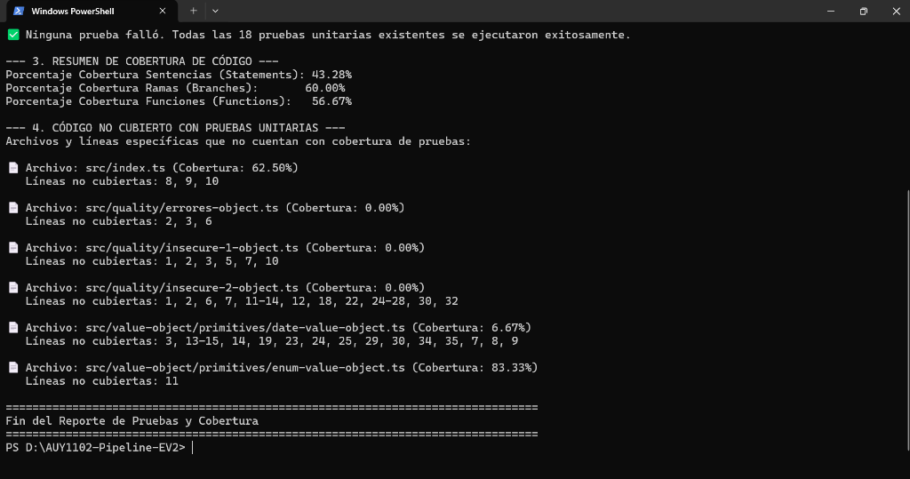
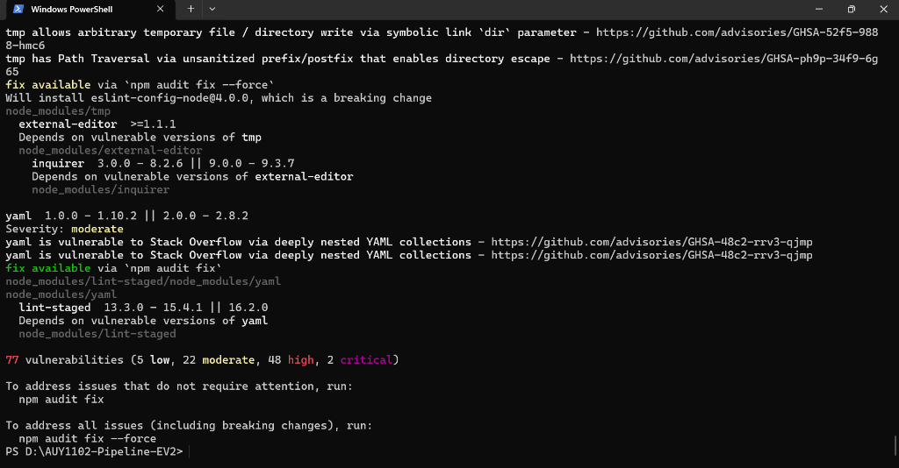
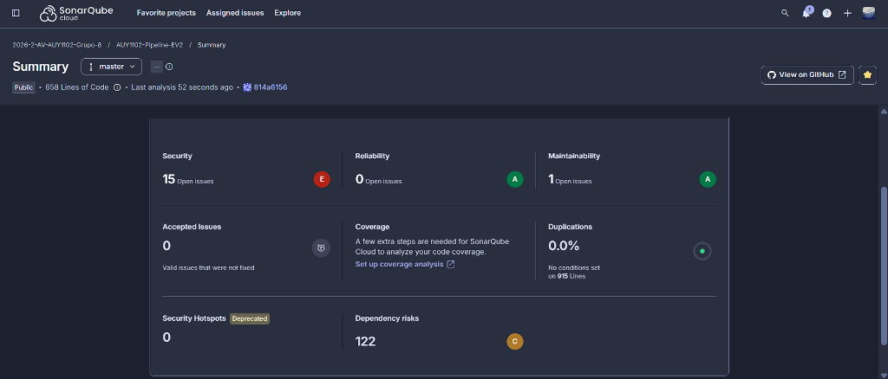
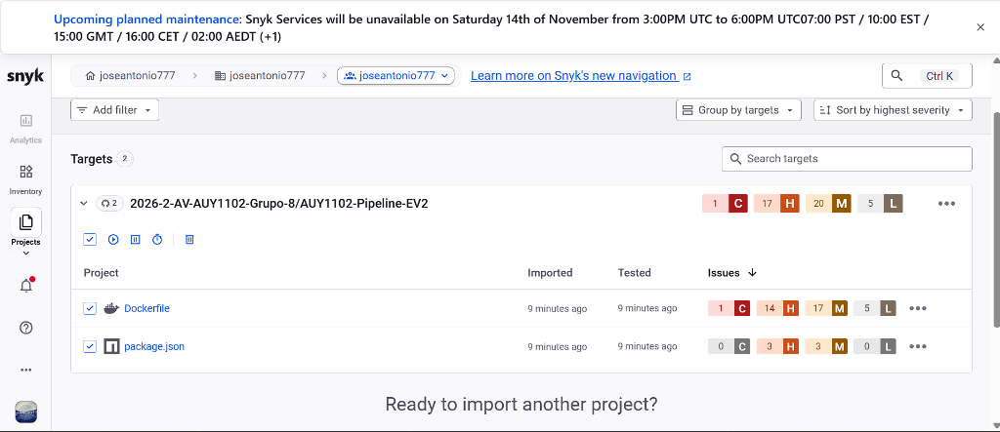
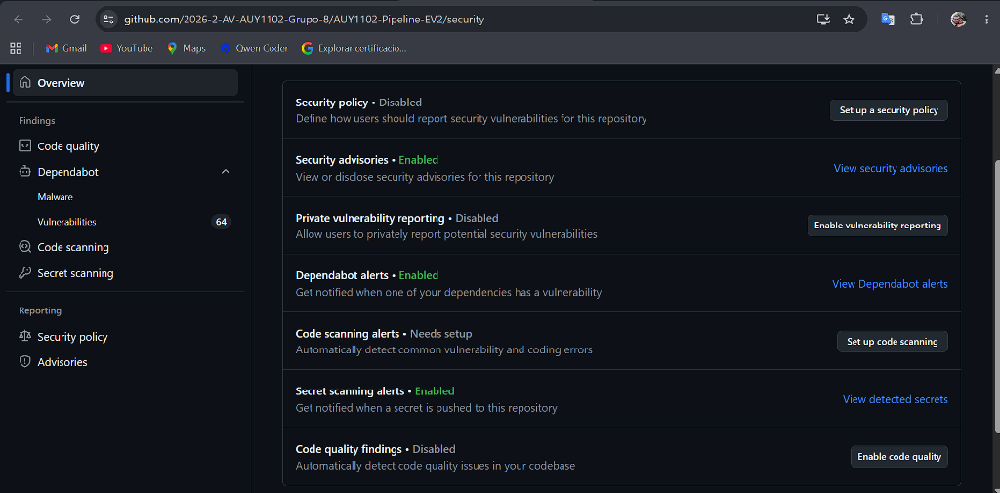

# AUY1102 - Pipeline CI/CD & DevSecOps
## Evaluación Parcial N° 2: Desarrollo de Pruebas Unitarias y Análisis de Seguridad II

**Asignatura:** Ciclo de vida del Software I (AUY1102)  
**Institución:** Instituto Profesional Duoc UC  
**Grupo:** N° 8  
**Integrantes:**
- **Fernando Galdamez** (GitHub: [@fergaldamez-commits](https://github.com/fergaldamez-commits) | `fer.galdamez@duocuc.cl`)
- **Jose Villarroel** (GitHub: [@Joseantonio777](https://github.com/Joseantonio777) | `jose.villarroelc@gmail.com`)

> 📘 **Informe Oficial de la Evaluación:** [Consulte aquí la documentación técnica completa paso a paso (DOCUMENTACION_EV2.md)](./DOCUMENTACION_EV2.md)

---

## 📸 Galería de Evidencias Reales del Proyecto

### 1. Pruebas Unitarias y Análisis de Cobertura (Parte 1)
Ejecución del script automatizado `npm run test:report` que ejecuta Jest, analiza las 18 pruebas unitarias (100% pasadas), calcula porcentajes de cobertura (Sentencias 43.28%, Ramas 60.00%, Funciones 56.67%) y lista en detalle los archivos y líneas no cubiertas:


---

### 2. Análisis de Vulnerabilidades en Dependencias con `npm audit` (Parte 2)
Ejecución del escaneo SCA en terminal detectando 77 vulnerabilidades conocidas en librerías transitivas del árbol de dependencias (`package-lock.json`):


---

### 3. Configuración e Integración con SonarCloud (Parte 2)
Panel de control de SonarQube Cloud para la organización `2026-2-AV-AUY1102-Grupo-8` y repositorio `AUY1102-Pipeline-EV2`, evidenciando el análisis de calidad, Security Rating E con 15 open issues, Reliability A y Maintainability A:


---

### 4. Escaneo de Seguridad con Snyk (Parte 2)
Análisis de seguridad SCA y SAST en la consola de Snyk para el repositorio `AUY1102-Pipeline-EV2`, detectando 1 vulnerabilidad crítica, 17 altas, 20 medias y 5 bajas en `Dockerfile` y `package.json`:


---

### 5. Activación de GitHub Advanced Security (GHAS) (Parte 2)
Panel de seguridad nativo en GitHub (`/security`) mostrando el monitoreo continuo de **64 vulnerabilidades en Dependabot**, **Secret Scanning activado** y **Security Advisories habilitados**:


---

### 6. Trabajo Colaborativo y Pull Requests en Git
Trazabilidad de ramas temáticas y Pull Requests entre **Jose Villarroel** (`feature/unit-tests-report`) y **Fernando Galdamez** (`fix/security-remediations`) para la integración continua en `master`.

---

## Comandos Rápidos del Proyecto

```bash
# 1. Instalar dependencias del proyecto
npm install --legacy-peer-deps

# 2. Ejecutar el script automatizado de pruebas unitarias y cobertura
npm run test:report

# 3. Ejecutar pruebas unitarias estándar
npm run test:unit

# 4. Ejecutar auditoría de seguridad de dependencias
npm audit
```

---

## Estructura del Repositorio

```text
AUY1102-Pipeline-EV2/
├── .github/              # Workflows de CI/CD y CodeQL
├── docs/                 # Documentación y directrices de contribución
├── img/                  # Capturas de pantalla reales de evidencias
├── scripts/
│   └── test-coverage-report.js  # Script automatizado de pruebas y cobertura
├── src/
│   ├── quality/          # Módulos de calidad y seguridad
│   └── value-object/     # Componentes y Value Objects del dominio
├── test/                 # Pruebas unitarias de Value Objects
├── DOCUMENTACION_EV2.md  # Informe formal completo para la evaluación
├── package.json          # Dependencias y comandos npm
├── README.md             # Portada y galería de evidencias
└── sonar-project.properties # Configuración para SonarCloud
```
